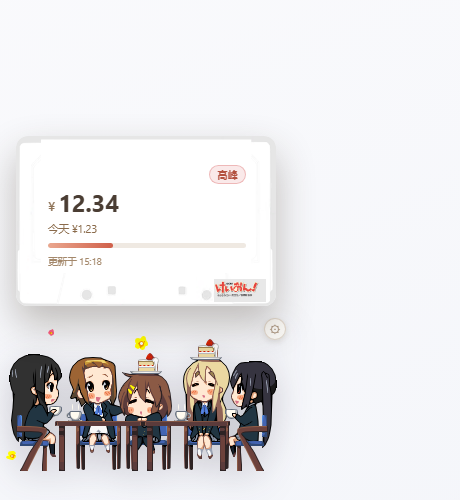
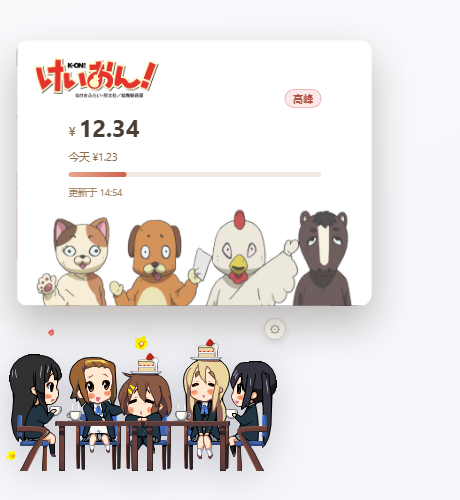
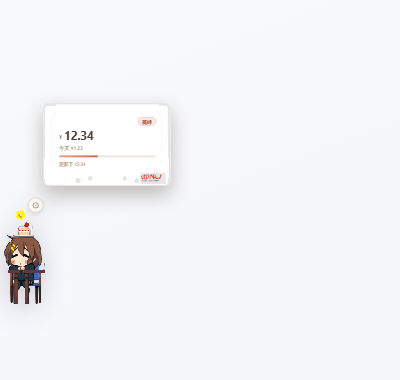
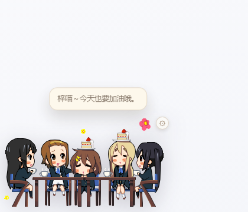
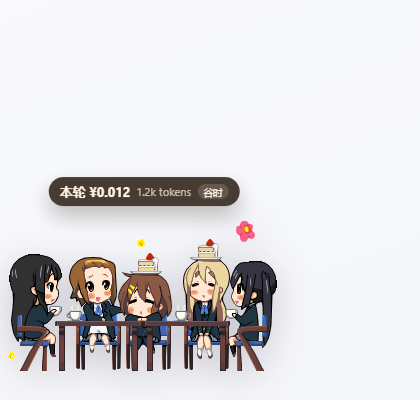
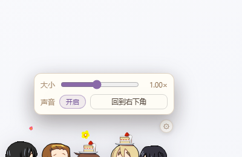
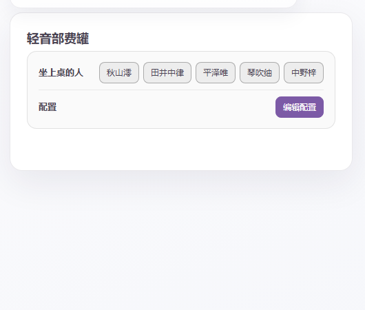
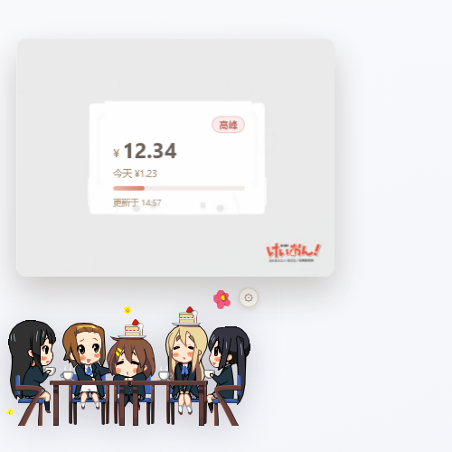

# 轻音部费罐 · dsh-kon-fee-widget

DSH 上的《轻音少女》部费挂件：**原版大茶桌**当底座，五人坐成一排；平时不显示数字，点一下茶桌才弹「部费账本」。

> 不是桌宠、不做提示音轰炸：只干三件事——**看余额、看今天花了多少、看现在是不是高峰**。



---

## 功能

| 功能 | 说明 | 截图 |
|---|---|---|
| 茶桌底座 | 原版 `desk00` 背景 + 五人坐姿 + `desk01` 前景三层切分，中间三人有坐姿动画 | 见下 |
| 点开账本 | 点茶桌弹出：右上角高峰/谷价标签、余额、今天花费、计价进度条、左下角更新时间；8 秒自动收起 | [卡带](docs/screenshots/01-bubble-cassette.png)｜[动物](docs/screenshots/02-bubble-mascot.png) |
| 高峰/谷价 | 标签配色区分（高峰橙红、谷价绿），进度条显示当前时段进度 | 同上 |
| 今天花费 | 宿主按 `turn/end` 累计当日金额，跨天自动归零 | 同上 |
| 每轮消耗 | 一轮对话结束用**信息窗**弹出：右上角「本轮」、金额、今天累计、更新时间（和余额账本同一套卡面） | [截图](docs/screenshots/06-turn-cost.png) |
| 双击彩蛋 | 按**在场的人**弹台词：单人在场只出本人台词；组合按概率触发 | [截图](docs/screenshots/05-easter-egg.png) |
| 中日对照 | 每条台词 `{zh, ja}`，配置里 `lang` 切换 | — |
| 语音 | 台词可带 `voice` 文件名，播放 `assets/voices/` 下的音频；齿轮菜单可关 | — |
| 人物可勾选 | 设置页五个按钮，关掉谁就连它那段桌子一起收起；全关则整桌不显示 | [截图](docs/screenshots/08-settings.png) |
| 拖拽 / 吸附 / Q 弹 | 拖动挪位置，边缘 24px 内自动贴边，按下有回弹 | — |
| 齿轮菜单 | 右上角齿轮：大小滑杆 + 声音开关 + 回到右下角 | [截图](docs/screenshots/07-gear-menu.png) |
| 气泡比例 | 气泡面积 =（桌子+人物面积）× `bubbleAreaRatio`（默认 1.3），人少时自动变小 | [0.7× 示例](docs/screenshots/09-scale-07.png) |
| 配置 | `~/.dsh/kon-fee-widget.json`（带注释 JSON）或设置页「编辑配置」弹窗 | — |

### 两种气泡背景

| 卡带 | 动物 |
|---|---|
|  |  |

### 其它截图

| 单人在场（桌子收短、气泡变小） | 双击彩蛋 |
|---|---|
|  |  |

| 每轮消耗 | 齿轮菜单 |
|---|---|
|  |  |

| 设置页 | 整张卡带原图 |
|---|---|
|  |  |

---

## 交互一览

| 操作 | 效果 |
|---|---|
| 单击茶桌 | 开/关账本 |
| 双击茶桌 | 弹彩蛋台词：单人在场只出本人一句；组合台词按「上一句 → 下一句」依次播放 |
| 点茶桌外任意处 | 收起账本 |
| 拖动 | 挪位置，松手吸附 |
| 右键 | 刷新余额并开账本 |
| 齿轮 | 开/关小菜单（会先收起账本） |
| 齿轮 → 大小 | 缩放整张桌子（气泡按面积比例跟随） |
| 齿轮 → 声音 | 开/关配音 |
| 齿轮 → 回到右下角 | 一键贴右下角 |

---

## 安装

### 桌面客户端（Electron）

1. 把本仓库复制到 `%USERPROFILE%\.dsh\profiles\desktop\node_modules\dsh-kon-fee-widget`；
2. 该 profile 的 `package.json` 里加依赖 `"dsh-kon-fee-widget": "file:<仓库路径>"`，并加进 `dsh.profile.bundles`；
3. **重启 DSH**（客户端包在启动时加载）。

### DSH Web

```bash
dsh plugin --profile web add github:xiao2236/dsh-kon-fee-widget
```

---

## 配置

完整字段、默认值、范围、示例：[`docs/config.md`](docs/config.md)。

概要（文件在 `~/.dsh/kon-fee-widget.json`，带注释，手改后刷新页面生效）：

```jsonc
{
  "visible": true,
  "characters": { "mio": true, "ritsu": true, "yui": true, "tsumugi": true, "azusa": true },
  "scale": 1,
  "snap": true,
  "refreshSeconds": 60,
  "warnBelow": 5,
  "turnBubble": true,
  "panelDurationMs": 8000,
  "bubbleStyle": "cassette",
  "bubbleAreaRatio": 1.3,
  "easterEgg": true,
  "eggLines": {},
  "eggComboChance": 0.5,
  "lang": "zh",
  "voice": true,
  "easterEggLines": []
}
```

---

## 余额与消耗怎么来的

```
浏览器 GET /dsh-kon-fee-widget/balance
  → 宿主 lib/index.js
     ├─ ctx.credentials.get("DEEPSEEK_API_KEY") → GET api.deepseek.com/user/balance
     ├─ 没 key 时退到 DSH 账号服务 deepseekAccount.getBalance()（充值钱包 + 赠金相加）
     ├─ 45 秒缓存 + 并发合并
     └─ 失败沿用上次余额（前端标注）
```

每轮消耗：宿主订阅 `session/event`，`assistant/message` 带真实 `usage`，按 `(session, turn)` 聚合，
`turn/end` 时用官方价目表（Flash / Pro，谷价/高峰两档）算钱，写进当天累计与 `last-turn`。
API key 不会下发到前端。

---

## 开发与测试

```bash
node scripts/build-client.mjs   # src/core.cjs + src/client.js → lib/client.js
node scripts/check.mjs          # 清单/素材/常量自检
node --test test/core.test.mjs test/host.test.mjs
```

目录：

```
src/core.cjs     纯逻辑（几何、峰谷、金额、吸附、彩蛋选择）
src/client.js    React 挂件 + 设置页（h() 创建元素，无打包器）
lib/index.js     宿主（静态素材、余额、配置、每轮消耗）
lib/client.js    构建产物
assets/table/    茶桌与五人坐姿
assets/ui/       气泡背景（卡带、动物、Logo）
assets/voices/   语音文件（放这里）
docs/            配置文档与截图
test/            单元测试 + 本地夹具
```

---

## 素材与许可

- **代码**：MIT。
- **茶桌、角色立绘**：取自原版 Windows 桌宠 `MascotTable.exe`（经 `dsh-k-on-pet` 项目整理），
  不属于 MIT，详见 [`THIRD_PARTY_NOTICES.md`](THIRD_PARTY_NOTICES.md)。
- **气泡背景（卡带 / 动物 / Logo）**：由使用者提供，版权归《K-ON!》相关权利方。
- 与 `dsh-whale-widget` 只有交互思路上的参考，**未复制其代码或素材**，见 [`NOTICE`](NOTICE)。
- 本项目是非官方同人作品，与权利方无关联。
